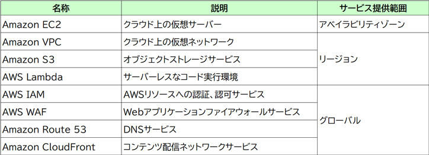

# AWS概要
AWSのコンピューティングリソースは、下記の単位で提供されています。
- グローバル：全世界
- リージョン：地域（「アジアパシフィック（東京）」や「米国東部（オハイオ）」など、地域で区切ったもののこと）
- アベイラビリティーゾーン（AZ）：1つ以上のデータセンターで構成される

全世界に共通するAWSサービスの提供範囲は、「グローバル」となる。

リージョン内の物理的および論理的に区切られた1つ以上のデータセンターを何というか。⇒アベイラビリティゾーン

- AWS IAM
- AWS WAF
- Amazon Route 53
といったサービスは、特定のリージョンやAZに寄らず利用できるので、グローバルに展開されているサービスと考える。

## Local Zone
Local Zonesはリージョンをよりユーザーに近い場所まで拡張した地域で、ユーザーと物理的な距離が近い場所で、ネットワーク遅延の影響を受けやすいAWSサービスを低遅延で実行できる。

（日本ではLocal Zoneは提供されていない。）

# 試験で問われるやっかいなテーマのまとめ
- 責任共有モデル
- Well-Architected Framework
- クラウド導入フレームワーク
- AWSサポート
