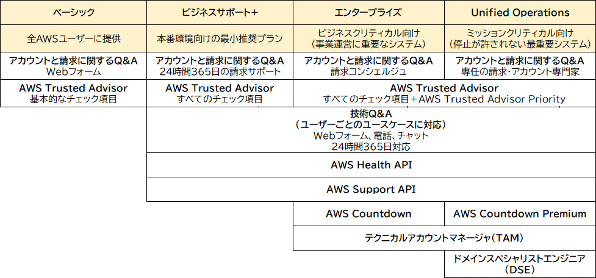
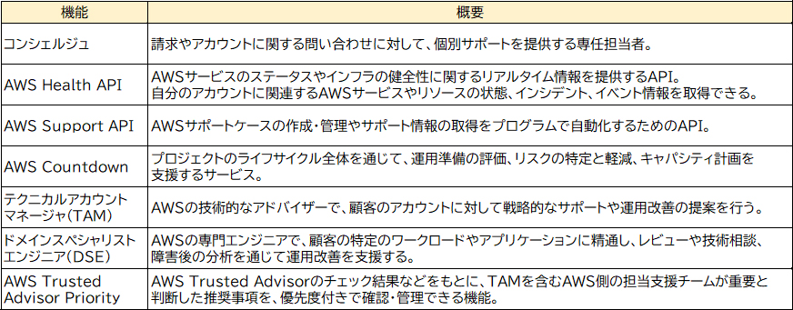

- [請求の管理](#請求の管理)
  - [AWS Organizations](#aws-organizations)
  - [AWS Billing Conductor](#aws-billing-conductor)
- [コスト管理](#コスト管理)
  - [AWS Pricing Calculator](#aws-pricing-calculator)
  - [AWS Budgets](#aws-budgets)
  - [請求ダッシュボード](#請求ダッシュボード)
  - [AWS Cost Explorer](#aws-cost-explorer)
  - [AWS Compute Optimizer](#aws-compute-optimizer)
  - [AWS Billing and Cost Management(新機能)](#aws-billing-and-cost-management新機能)
- [AWSサポート](#awsサポート)
  - [ベーシック](#ベーシック)
  - [ビジネスサポート+](#ビジネスサポート)
  - [エンタープライズ](#エンタープライズ)
  - [Unified Operations（統合オペレーション）](#unified-operations統合オペレーション)
  - [AWSプロフェッショナルサービス (Ping-t)](#awsプロフェッショナルサービス-ping-t)
- [その他のサポートツール](#その他のサポートツール)
  - [請求アラート](#請求アラート)
  - [コスト配分タグ](#コスト配分タグ)
  - [使用状況レポート](#使用状況レポート)
  - [サービスクォータ](#サービスクォータ)
  - [AWS Personal Health Dashboard](#aws-personal-health-dashboard)
  - [AWS Marketplace](#aws-marketplace)
  - [AWS Health Dashboard](#aws-health-dashboard)
  - [AWS re:Post 〇](#aws-repost-〇)
  - [AWS Launch Wizard](#aws-launch-wizard)
  - [AWS Data Exchange](#aws-data-exchange)
  - [AWS適正利用規約 (AWSが提供するサービスの利用における禁止事項を記載したもの)](#aws適正利用規約-awsが提供するサービスの利用における禁止事項を記載したもの)

# 請求の管理
## AWS Organizations
複数のAWSアカウントを組織としてまとめて管理することができる。
利用料金の請求を管理アカウントにまとめることができる。
EC2やRDSのリザーブドインスタンスをAWSOrganizationsで管理されているメンバーアカウント同士で共有することができる。

## AWS Billing Conductor
AWSアカウントを払い出されている顧客側から自分たちの請求書を確認したいという場合に使える。

# コスト管理
## AWS Pricing Calculator
AWSの利用に伴う費用の見積もり・概算ができる。

## AWS Budgets
AWS利用料金の予算を予め設定し、予算に対する実際のコストの割合を管理することができる。

## 請求ダッシュボード
当月の利用料金を確認できる。

## AWS Cost Explorer
請求ダッシュボードより細かくコストを分析することができる。
日にちベースでの集計もできるので、いつもと違うコストの発生を検知しやすい。

## AWS Compute Optimizer
リソース(EC2,EBS, Lambda)の利用状況から、リソースが最適かどうかを報告してくれるツール。

## AWS Billing and Cost Management(新機能)
AWSの利用にかかっているコストを分析するためのツールで、新機能。
https://recipe.kc-cloud.jp/archives/5843/

# AWSサポート
AWSサポートは、複数のサポートプランを通じて、技術的問題解決と運用支援を継続的に提供しており、 
AWSの利用に関する技術的な問題解決や運用支援を直接問い合わせできるサービス。
以下のサポートプラン比較表を抑えておけばOK

## ベーシック
- Trusted Advisorは基本的なセキュリティとサービスクォータのみ

## ビジネスサポート+
- クラウドサポートエンジニアへ年中無休の電話、Webでの問い合わせ、チャット利用ができる
- フルセットでTrusted Advisorのサポートが受けられる

## エンタープライズ
- クラウドサポートエンジニアへ年中無休の電話、Webでの問い合わせ、チャット利用ができる
- フルセットでTrusted Advisorのサポートが受けられる
- コンシェルジュ支援が受けられる。
- テクニカルアカウントマネージャー（TAM）のサポートが受けられる

## Unified Operations（統合オペレーション）
Unified Operationsは、停止が許されない最重要システムを運用する大規模企業向けの最上位サポートプランです。
AIを活用した分析やAWSの専門家による継続的な支援を通じて、運用上の問題やセキュリティ上のリスクを早期に把握し、
障害発生時の迅速な解決を支援します。
担当の**テクニカルアカウントマネージャー（TAM）**や**ドメインスペシャリストエンジニア（DSE）**などが連携し、
ワークロードのレビュー、技術的なアドバイス、24時間365日のワークロードモニタリングやインシデント対応支援を行います。
また、AWS Trusted Advisorの全チェックに加えて、AWS Trusted Advisor Priorityも利用できます。
さらに、Unified Operationsには、AWS Countdown Premiumが含まれています。
AWS Countdown Premiumでは、新サービスのリリース、大規模な移行、セールやキャンペーンなどの重要イベントに向けて、計画段階からイベント当日、イベント後の振り返りまで、担当エンジニアによる手厚い支援を受けられます。

## AWSプロフェッショナルサービス (Ping-t)
AWSプロフェッショナルサービスは、**AWSの専門チームが提供するプロジェクトベースの高度なコンサルティングおよび技術サービス**です。
- クラウド環境の設計・構築・最適化 を支援する。
AWSクラウドの導入や既存環境の拡張などのプロジェクト単位で、クラウド環境の設計・構築・最適化を包括的に支援します。
AWSサポートは日々の運用サポートを継続的に提供しますが、プロフェッショナルサービスはプロジェクト単位の期間限定支援です。

- AWSサポート＝日々の運用のサポート
- プロフェッショナルサービス＝プロジェクト単位の期間限定の支援

# その他のサポートツール
## 請求アラート
## コスト配分タグ
## 使用状況レポート
## サービスクォータ
## AWS Personal Health Dashboard
## AWS Marketplace
## AWS Health Dashboard
AWS Health Dashboardは、AWSが提供する各サービスの稼働状況や、自身のAWSアカウントに影響を与えるイベントや問題をリアルタイムで一元的に確認できるダッシュボードです。

## AWS re:Post 〇
AWSのユーザ同士が悩み事を相談して解決策をやり取りするためのコミュニケーションツール。
AWSサポートへ問い合わせる前にここを調べてみるといった使い方をする。

## AWS Launch Wizard
## AWS Data Exchange

## AWS適正利用規約 (AWSが提供するサービスの利用における禁止事項を記載したもの)
AWS適正利用規約は、AWSが提供するサービスの利用における禁止事項を記載したもので、
AWSが提供するサービスに関する法的文書の一つです。サービスの利用における禁止事項が記載されています。 
（例：違法行為やセキュリティ侵害、大量の迷惑メール送信などのスパム行為を目的とした利用）
