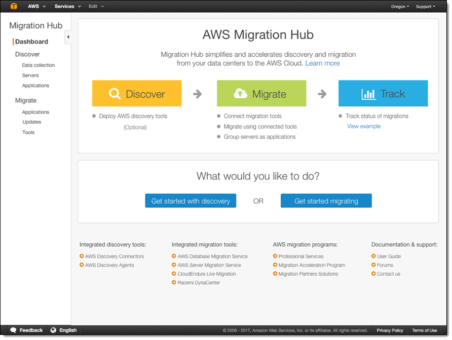

- [Well-Architectedフレームワーク](#well-architectedフレームワーク)
  - [運用上の優秀性の柱 (システム運用する上での自動化、プロセスや手順の継続的な改善についての事項)](#運用上の優秀性の柱-システム運用する上での自動化プロセスや手順の継続的な改善についての事項)
  - [セキュリティの柱 (データの情報セキュリティ、システムの保護(ユーザ管理・アクセス権限)に関する事項)](#セキュリティの柱-データの情報セキュリティシステムの保護ユーザ管理アクセス権限に関する事項)
  - [信頼性の柱 (信頼性の確保の仕方と迅速な回復などの事項)](#信頼性の柱-信頼性の確保の仕方と迅速な回復などの事項)
  - [パフォーマンス効率の柱 (コンピューティングリソースの最適化、パフォーマンスのモニタリングについての事項)](#パフォーマンス効率の柱-コンピューティングリソースの最適化パフォーマンスのモニタリングについての事項)
  - [コスト最適化の柱 (不要なコストを回避して、コスト最適化するための必要な事項)](#コスト最適化の柱-不要なコストを回避してコスト最適化するための必要な事項)
  - [持続可能性の柱 (実行中のシステムが環境に対して与える影響を最小限に抑えることについての事項)](#持続可能性の柱-実行中のシステムが環境に対して与える影響を最小限に抑えることについての事項)
  - [AWS規範ガイダンス](#aws規範ガイダンス)
- [クラウドへの移行](#クラウドへの移行)
  - [クラウド導入フレームワーク（CAF）](#クラウド導入フレームワークcaf)
    - [クラウド導入フレームワーク 6つのパースペクティブ](#クラウド導入フレームワーク-6つのパースペクティブ)
      - [ビジネス (クラウドへの移行や投資の目的やゴールについて考える視点)](#ビジネス-クラウドへの移行や投資の目的やゴールについて考える視点)
      - [人材 (変化を受け入れる組織や文化を醸成するためのリーダーシップや人材育成の視点)](#人材-変化を受け入れる組織や文化を醸成するためのリーダーシップや人材育成の視点)
      - [ガバナンス (組織としてリスクを最小化しながらクラウド移行を推進するための視点)](#ガバナンス-組織としてリスクを最小化しながらクラウド移行を推進するための視点)
      - [プラットフォーム (拡張性のあるクラウドプラットフォームの構築や、モダナイズするための視点)](#プラットフォーム-拡張性のあるクラウドプラットフォームの構築やモダナイズするための視点)
      - [セキュリティ (データやクラウドインフラについて、高い機密性・完全性・可用性を実現するための視点)](#セキュリティ-データやクラウドインフラについて高い機密性完全性可用性を実現するための視点)
      - [オペレーション (ビジネス要求を満たすサービスの提供を実現するための視点)](#オペレーション-ビジネス要求を満たすサービスの提供を実現するための視点)
    - [クラウド導入フレームワーク 4つの利点](#クラウド導入フレームワーク-4つの利点)
    - [クラウドトランスフォーメーションの価値連鎖（バリューチェーン）](#クラウドトランスフォーメーションの価値連鎖バリューチェーン)
  - [移行をサポートするサービス](#移行をサポートするサービス)
    - [AWS Transform](#aws-transform)
    - [AWS Application Migration Service](#aws-application-migration-service)
    - [AWS Migration Hub](#aws-migration-hub)

# Well-Architectedフレームワーク
AWSが提唱するクラウド設計・運用のベストプラクティスをまとめたもの。 
6つの柱ごとにジャンルに分かれていて、設計原則とベストプラクティスが紹介されている。
- 運用上の優秀性の柱
- セキュリティの柱
- 信頼性の柱
- パフォーマンス効率の柱
- コスト最適化の柱
- 持続可能性の柱

## 運用上の優秀性の柱 (システム運用する上での自動化、プロセスや手順の継続的な改善についての事項)
運用プロセスを自動化し、変更管理を効率的にする、障害を予想する、変更に問題があっても容易に戻せるといったことを行うことで運用リスクを最小化すること。

## セキュリティの柱 (データの情報セキュリティ、システムの保護(ユーザ管理・アクセス権限)に関する事項)
適切なアクセス管理、認証・認可の範囲を考えること。 
データやシステムを保護し、ユーザーのセキュリティ体制を向上させる。

## 信頼性の柱 (信頼性の確保の仕方と迅速な回復などの事項)
信頼性とは？→障害からいかに復旧するか

## パフォーマンス効率の柱 (コンピューティングリソースの最適化、パフォーマンスのモニタリングについての事項)
リソースを効率的に使用し、需要の変化や技術の進歩に応じて最適なパフォーマンスを維持する

## コスト最適化の柱 (不要なコストを回避して、コスト最適化するための必要な事項)
コストを抑えつつ、リソースを効率的に活用して投資利益率（ROI）を最大化する

## 持続可能性の柱 (実行中のシステムが環境に対して与える影響を最小限に抑えることについての事項)
持続可能性とは？→実行中のシステムが実行環境に対するアプローチとして適切そうなものを選ぶ。 
復旧時間、復旧時点を考慮したバックアップ戦略を策定する。 
ワークロードが環境に与える影響を理解し、持続可能な運用を行う。 
が該当する。

## AWS規範ガイダンス
Well-Architectedフレームワークに沿ったアーキテクチャ設計を手助けするリソース。
具体的な設計パターンやガイドラインが公開されている。 
https://aws.amazon.com/jp/prescriptive-guidance/

# クラウドへの移行
クラウドを利用すると、初期費用とランニングコストを抑えることができるので、総所有コスト(TCO)が下がる。

## クラウド導入フレームワーク（CAF）
AWSクラウド導入フレームワークとは、AWSクラウドを効率的かつ効果的に導入するためのガイドラインとベストプラクティスをまとめたもの。

### クラウド導入フレームワーク 6つのパースペクティブ
- ビジネス
- 人材
- ガバナンス
- プラットフォーム
- セキュリティ
- オペレーション

#### ビジネス (クラウドへの移行や投資の目的やゴールについて考える視点)
#### 人材 (変化を受け入れる組織や文化を醸成するためのリーダーシップや人材育成の視点)
#### ガバナンス (組織としてリスクを最小化しながらクラウド移行を推進するための視点)
#### プラットフォーム (拡張性のあるクラウドプラットフォームの構築や、モダナイズするための視点)
- プログラムおよびプロジェクト管理 … 複数のクラウド導入プロジェクトを統合・調整し、コストやスケジュール、利益を最適化します。進捗を定期的に見直し、課題を迅速に解決します。
- ベネフィット管理 … クラウド導入によるビジネス成果を定義し、その進捗を追跡・評価する役割を担います。ベネフィットの実現のためのロードマップを策定し、ステークホルダーと共有しながら、必要に応じて調整を行います。
- リスク管理 … クラウド導入に伴うオペレーションリスクやビジネスリスクを特定し、緩和策を講じます。クラウドの柔軟性を活用してリスクを最小化します。
- クラウド財務管理 … クラウドコストを計画、測定、最適化し、財務上の説明責任を明確化します。リソースの使用状況を可視化し、無駄を削減します。
- アプリケーションポートフォリオ管理 … ビジネス戦略に基づいてアプリケーションを管理・最適化し、アプリケーション全体の状態を評価して改善を図ります。また、ライフサイクルを計画的に管理し、効率的な運用を実現します。
- データガバナンス … データの所有権やライフサイクルを管理し、データ品質やコンプライアンスを維持します。データ管理の役割とルールを明確化します。
- データキュレーション … **メタデータやデータカタログを活用して、データの収集、整理、タグ付けを行います。データの発見や分析を促進し、収益化を支援します。**

#### セキュリティ (データやクラウドインフラについて、高い機密性・完全性・可用性を実現するための視点)
クラウド基盤のセキュリティ強化を優先し、アクセス管理とデータ保護を強化する

#### オペレーション (ビジネス要求を満たすサービスの提供を実現するための視点)

### クラウド導入フレームワーク 4つの利点
- ビジネスリスクの軽減
- 環境、社会、ガバナンスに関するパフォーマンスの向上
- 収益の拡大
- 業務効率の拡大

### クラウドトランスフォーメーションの価値連鎖（バリューチェーン）
・技術（Technology）変革：古いITインフラやアプリケーションを最新化し、コスト削減やシステム管理の効率化を進める。
・プロセス（Process）変革：ビジネスのデジタル化・自動化を進め、業務の効率を向上させることに重点を置きます。
・組織（Organization）変革：製品や価値の流れを中心にチームを編成し、アジャイル手法を導入して迅速に改善を繰り返す
・製品（Product）変革：新しい製品・サービスやビジネスモデルを生み出し、競争力を強化する

## 移行をサポートするサービス
### AWS Transform
### AWS Application Migration Service
オンプレ環境からEC2に移行するために使うサービス。

### AWS Migration Hub
AWSへの移行計画や評価・追跡を行うために、様々なサービスと連携して、情報の収集とダッシュボード機能を提供するサービス。

