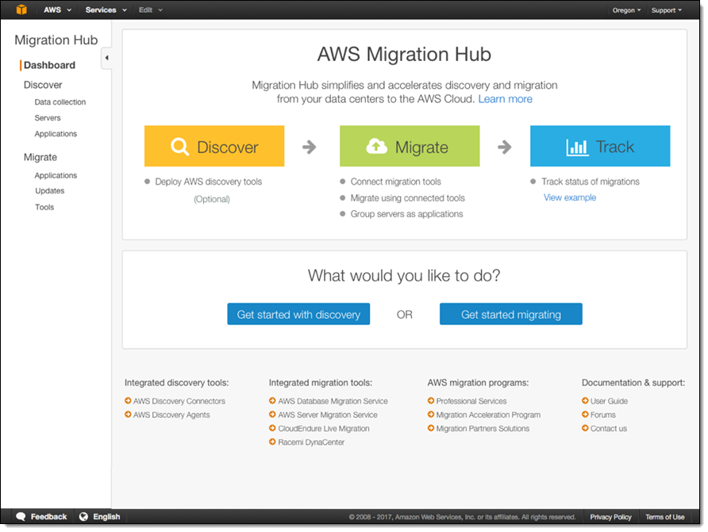

# Well-Architectedフレームワーク
TODO: ここを追加する

## AWS規範ガイダンス
Well-Architectedフレームワークに沿ったアーキテクチャ設計を手助けするリソース。
具体的な設計パターンやガイドラインが公開されている。 
https://aws.amazon.com/jp/prescriptive-guidance/

# クラウドへの移行
クラウドを利用すると、初期費用とランニングコストを抑えることができるので、総所有コスト(TCO)が下がる。

## クラウド導入フレームワーク（CAF）
### クラウド導入フレームワーク 6つのパースペクティブ
- ビジネス
- 人材
- ガバナンス
- プラットフォーム
- セキュリティ
- オペレーション

### クラウド導入フレームワーク 4つの利点
- ビジネスリスクの軽減
- 環境、社会、ガバナンスに関するパフォーマンスの向上
- 収益の拡大
- 業務効率の拡大

## 移行をサポートするサービス
### AWS Transform
### AWS Application Migration Service
オンプレ環境からEC2に移行するために使うサービス。

### AWS Migration Hub
AWSへの移行計画や評価・追跡を行うために、様々なサービスと連携して、情報の収集とダッシュボード機能を提供するサービス。

