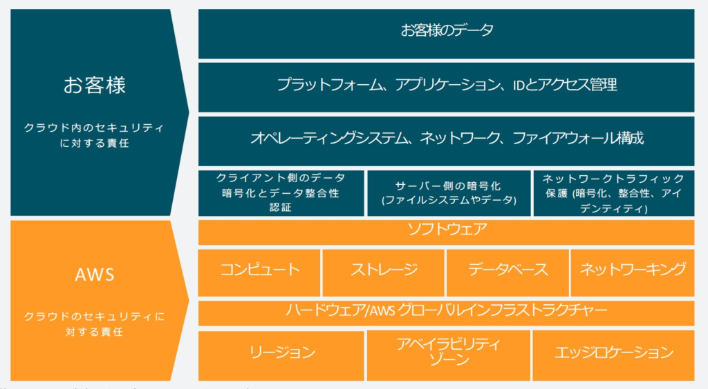

# 責任共有モデル

## AWS側のセキュリティ責任
## 利用者側のセキュリティ責任
## AWS側と利用者側の両方の責任（共有統制）
共有統制とは、AWSとユーザーがそれぞれの役割に基づいて分担して管理する統制です。インフラストラクチャの管理に関してはAWSが責任を負い、ユーザーはその上でゲストOS、アプリケーション、データベースなどの管理を行います。具体的な例は以下の通りです。
- パッチ管理：AWSはインフラストラクチャのパッチ適用を担当し、ユーザーはゲストOSやアプリケーションのパッチ適用を担当します。
- 構成管理：AWSはインフラストラクチャの構成管理を行い、ユーザーはゲストOSやデータベース、アプリケーションの構成に責任を負います。
- 意識とトレーニング：AWSはAWS従業員に対してセキュリティトレーニングを提供し、ユーザーは自社従業員へセキュリティトレーニングを実施します。

### 例 AWS Lambdaを使用する場合、AWS責任共有モデルでユーザーの責任となるタスクは？
- Lambda関数のバージョン管理
- Lambda関数のコード内部のセキュリティ
- メモリサイズなどのリソースに関する設定
- Lambda関数のコードの作成と更新
AWS Lambdaの利用にあたって、ユーザーはLambda関数を実行するため
- Lambda関数のコード作成と更新、環境変数や実行ロールなどアプリケーションに関する設定
- Lambda関数のメモリサイズや最大実行時間の指定などリソースに関する設定
などを行います。

# コンプライアンス

# データ暗号化
暗号化を行うサービス
→AWS KMS
→AWS CloudHSM

# セキュリティ評価
AWS Trusted Advisor p.338

# アカウント管理
### AWS Control Tower(p.122)
複数AWSアカウントのAWS環境を自動的に構成管理する。

### AWS IAM Identity Center(p.117)

# アプリケーションの保護
## Amazon
## AWS
## AWS
## Amazon Macie

# セキュリティ評価
## Amazon GuardDuty
## Amazon Detective
## Amazon Inspector
## AWS Trusted Advisor
## AWS Security Hub
