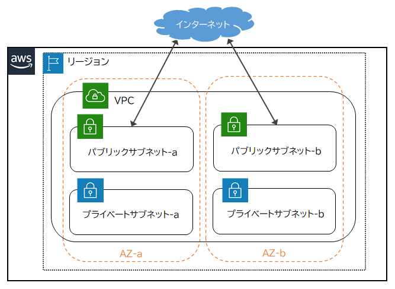
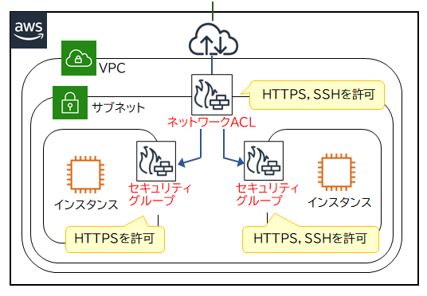
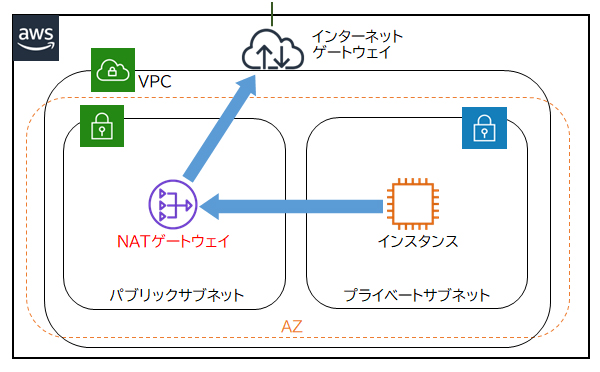
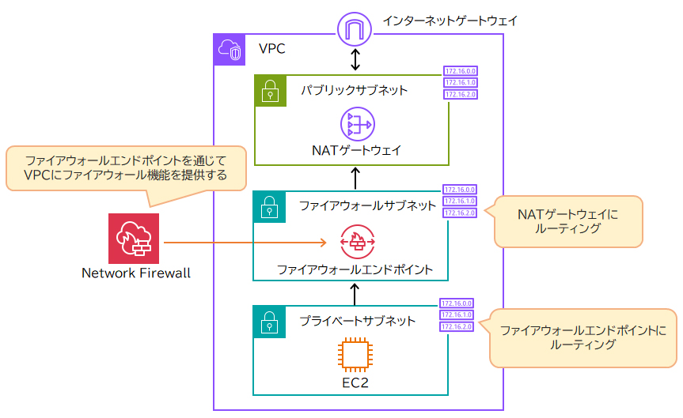
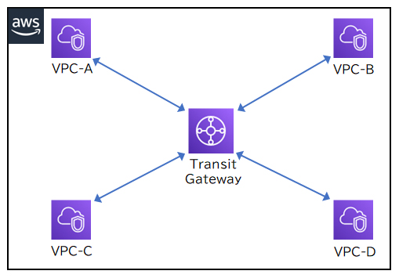

## Amazon VPC
サブネットは1つのAZに属する。

VPC内のネットワーク制御は、**ネットワークACL**と**セキュリティグループ**で制御する。

## Elastic IP
Elastic IPアドレスは、インターネットと通信可能な固定のパブリックIPアドレスです。
Elastic IPアドレスは割り当てたAWSリソースが終了しても同一のIPアドレスが保有されるので、利用料金が発生し続けます。
**また、保有しているElastic IPアドレスを使用して、同一のIPアドレスを別のAWSリソースに再び割り当てられます。**

Elastic IPアドレスは割り当てられているAWSリソースを終了しても、Elastic IPアドレスを解放するまで利用料金が課金される。

## ネットワークACL
ネットワークACLは、VPC内でサブネット単位にネットワークアクセスを制御するファイアウォールです。
IPアドレスを元に**許可ルール**と**拒否ルール**の両方を設定可能です。
サブネット単位で設定するので、同一サブネット内にあるEC2インスタンス間の通信は制限できない。

## NATゲートウェイ 〇
NATゲートウェイはプライベートサブネットからインターネットへの通信を可能にする機能です。
NATゲートウェイはプライベートサブネット内リソースからインターネットへの接続開始要求は通しますが、
インターネットからプライベートサブネット内リソースへの接続開始要求は通しません。

## AWS Network Firewall
VPC向けの高度なファイアウォール機能を提供するサービス。
- 侵入防止システム（IPS）
- ドメイン名によるトラフィックのフィルタリング

といった機能が提供されている。

Network Firewallは、VPC内のアウトバウンド及びインバウンド両方のトラフィックを検査できます。
インターネット上の特定のドメイン名を含むURLへのアクセスのみを許可したり、
特定の送信元からのトラフィック以外は全てブロックするなど、きめ細かな通信の制御が可能です。
セキュリティグループとネットワークACLがシンプルな機能の無料サービスである一方、
Network Firewallは高度な設定が可能な有料サービスです。

## AWS Transit Gateway(未掲載)
WS Transit Gatewayは、複数のVPCや複数のオンプレミスネットワークを相互に接続するハブ機能を持つサービスです。
VPCピアリングはVPC同士を1対1で接続するサービスなのに対し、
Transit Gatewayは複数のVPCを1つのハブで相互に接続できるので、ネットワーク経路を簡素化できます。

複数のVPCを相互に接続したい。VPCは将来的に増加する予定であり、相互接続も同様に増える想定である場合に使う。

