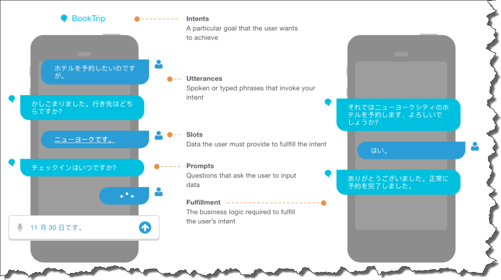
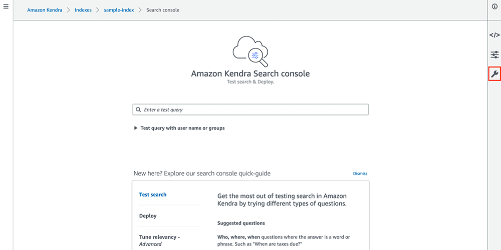
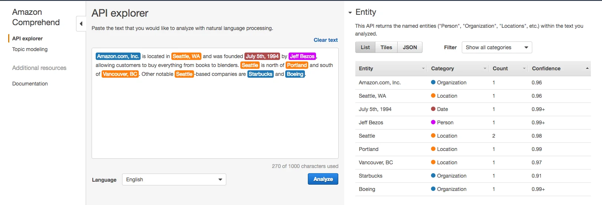
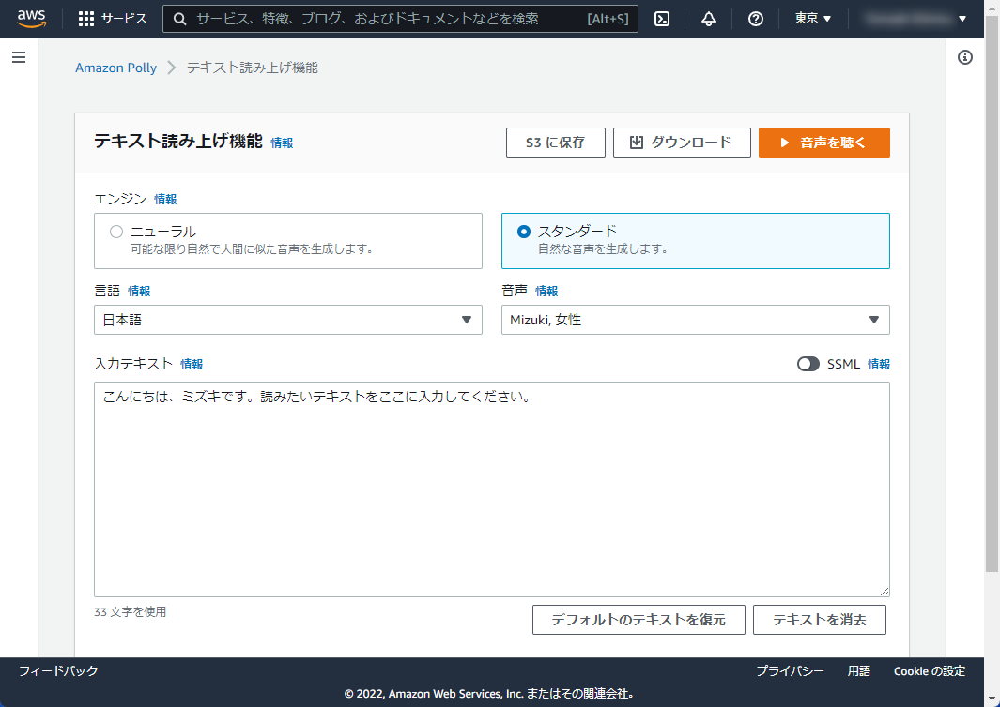

# 機械学習/深層学習系
## Amazon SageMaker
機械学習するためのモデルやトレーニングを行う環境を提供するサービス。

## Amazon Lex
会話型のAIチャットインターフェースの構築とデプロイを行うサービス 
https://aws.amazon.com/jp/blogs/news/amazon-lex-tokyo/

## Amazon Kendra
検索システムを構築するためのサービス。検索アルゴリズムには、機械学習や自然言語処理が用いられていることから機械学習系の章に含まれている。

## Amazon Comprehend
文章の感情分析を行うためのサービス。入力された文章がポジティブなのかネガティブなのかといった情報が割合で表示される。

## Amazon Polly
テキストを音声に変換するサービス。

## Amazon Rekognition
## Amazon Textract
## Amazon Translate

# データ分析
## Amazon Athena
## Amazon Kinesis
## Amazon QuickSight
## AWS Glue
## Amazon EMR
## Amazon Managed Streaming for Apache Kafka
## Amazon OpenSearch Service
