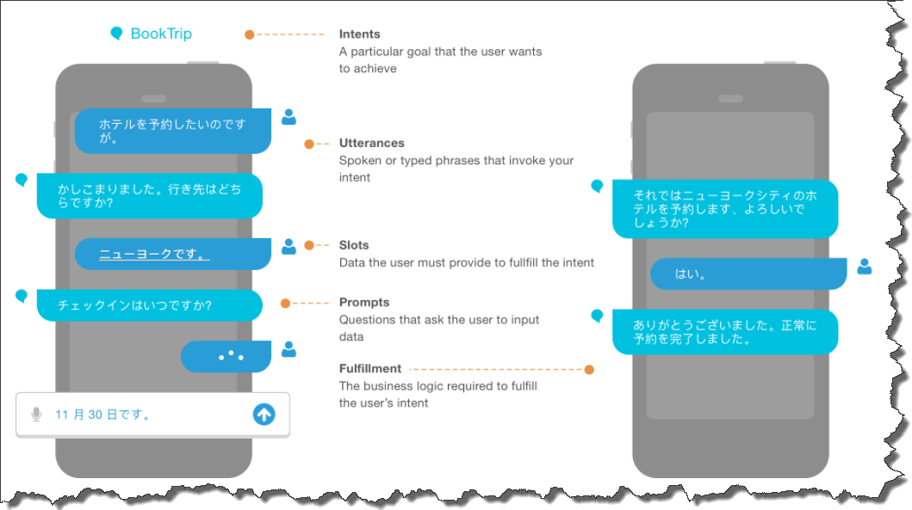
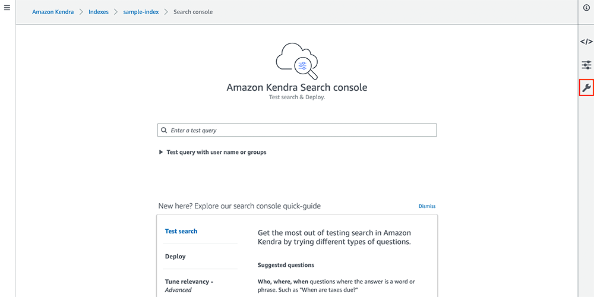
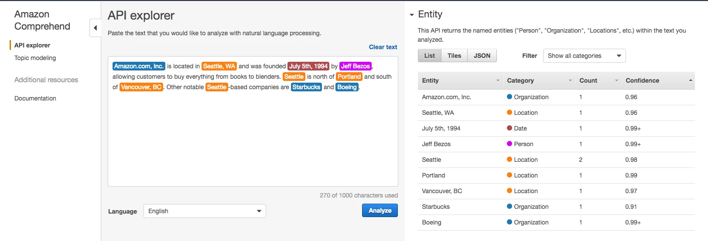
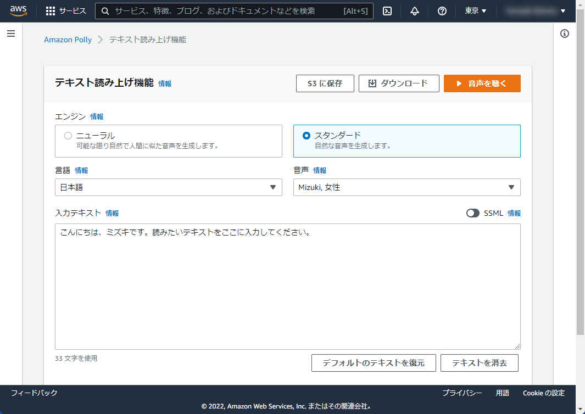
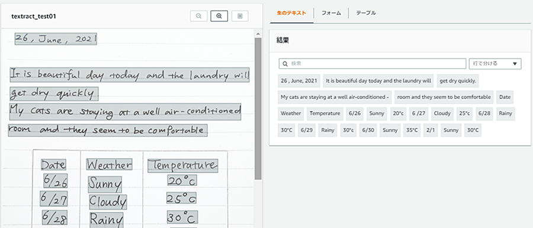

- [機械学習/深層学習系](#機械学習深層学習系)
  - [Amazon SageMaker (機械学習するためのモデルやトレーニングを行う環境を提供するサービス)](#amazon-sagemaker-機械学習するためのモデルやトレーニングを行う環境を提供するサービス)
  - [Amazon Lex (会話型のAIチャットインターフェースの構築とデプロイを行うサービス)](#amazon-lex-会話型のaiチャットインターフェースの構築とデプロイを行うサービス)
  - [Amazon Kendra (検索システムを構築するためのサービス)](#amazon-kendra-検索システムを構築するためのサービス)
  - [Amazon Comprehend (文章の感情分析を行うためのサービス)](#amazon-comprehend-文章の感情分析を行うためのサービス)
  - [Amazon Rekognition (画像認識や動画の分析を自動化するサービス)](#amazon-rekognition-画像認識や動画の分析を自動化するサービス)
  - [Amazon Polly (テキスト⇒音声への変換をするサービス)](#amazon-polly-テキスト音声への変換をするサービス)
  - [Amazon Textract (光学文字認識を行うサービス)](#amazon-textract-光学文字認識を行うサービス)
  - [Amazon Transcribe (音声⇒テキストへの変換をするサービス (コールセンターでの会話を文字起こしするなど))](#amazon-transcribe-音声テキストへの変換をするサービス-コールセンターでの会話を文字起こしするなど)
  - [Amazon Translate (翻訳を行うサービス)](#amazon-translate-翻訳を行うサービス)
  - [Amazon Personalize (ユーザーのデータをもとに商品や動画などのレコメンデーション（おすすめ）を生成するサービス)](#amazon-personalize-ユーザーのデータをもとに商品や動画などのレコメンデーションおすすめを生成するサービス)
- [データ分析](#データ分析)
  - [Amazon Athena (S3のオブジェクトを対象に、SQLを実行してデータ分析や抽出に使うことができる)](#amazon-athena-s3のオブジェクトを対象にsqlを実行してデータ分析や抽出に使うことができる)
  - [Amazon Kinesis (動画やデータストリームをリアルタイムにAWSリソースに取り込む)](#amazon-kinesis-動画やデータストリームをリアルタイムにawsリソースに取り込む)
  - [Amazon QuickSight (収集したデータの可視化を行うサービス)](#amazon-quicksight-収集したデータの可視化を行うサービス)
  - [AWS Glue (複数のデータソースからデータを抽出し、変換・統合したデータをターゲットへ格納する)](#aws-glue-複数のデータソースからデータを抽出し変換統合したデータをターゲットへ格納する)
  - [Amazon EMR](#amazon-emr)
  - [Amazon Managed Streaming for Apache Kafka (Amazon MSK)](#amazon-managed-streaming-for-apache-kafka-amazon-msk)
  - [Amazon OpenSearch Service](#amazon-opensearch-service)
  - [Amazon Data Firehose](#amazon-data-firehose)

# 機械学習/深層学習系
## Amazon SageMaker (機械学習するためのモデルやトレーニングを行う環境を提供するサービス)
機械学習するためのモデルやトレーニングを行う環境を提供するサービス。

## Amazon Lex (会話型のAIチャットインターフェースの構築とデプロイを行うサービス)
会話型のAIチャットインターフェースの構築とデプロイを行うサービス 
https://aws.amazon.com/jp/blogs/news/amazon-lex-tokyo/

## Amazon Kendra (検索システムを構築するためのサービス)
検索システムを構築するためのサービス。検索アルゴリズムには、機械学習や自然言語処理が用いられていることから機械学習系の章に含まれている。

## Amazon Comprehend (文章の感情分析を行うためのサービス)
文章の感情分析を行うためのサービス。入力された文章がポジティブなのかネガティブなのかといった情報が割合で表示される。

## Amazon Rekognition (画像認識や動画の分析を自動化するサービス)
画像認識や動画の分析を自動化するサービス。

## Amazon Polly (テキスト⇒音声への変換をするサービス)
テキストを音声に変換するサービス。（テキスト⇒音声）

## Amazon Textract (光学文字認識を行うサービス)
スキャンされた文書を読み込む光学文字認識(OCR)を提供するサービス。
（画像から文字認識して文字を読み取るなど。）

## Amazon Transcribe (音声⇒テキストへの変換をするサービス (コールセンターでの会話を文字起こしするなど))
音声をテキストに変換するAIサービス。（音声⇒テキスト） 
Transcribeで文字起こしに使うことができる。（コールセンターで会話の音声を文字に起こすなど）

## Amazon Translate (翻訳を行うサービス)
翻訳を行うサービス。名前で想像できる通り。

## Amazon Personalize (ユーザーのデータをもとに商品や動画などのレコメンデーション（おすすめ）を生成するサービス)
Amazon Personalizeは、ユーザーのデータをもとに商品や動画などのレコメンデーション（おすすめ）を生成するサービスです。 
https://aws.amazon.com/jp/pm/personalize/

# データ分析
## Amazon Athena (S3のオブジェクトを対象に、SQLを実行してデータ分析や抽出に使うことができる)
S3のオブジェクトを対象に、SQLを実行してデータ分析や抽出に使うことができる。

## Amazon Kinesis (動画やデータストリームをリアルタイムにAWSリソースに取り込む)
動画やデータストリームをリアルタイムにAWSリソースに取り込むことができる。

## Amazon QuickSight (収集したデータの可視化を行うサービス)
Athenaなどで収集したデータの可視化を行うサービス。

## AWS Glue (複数のデータソースからデータを抽出し、変換・統合したデータをターゲットへ格納する)
複数のデータソースからデータを抽出し、変換・統合したデータをターゲットへ格納するサービス。

## Amazon EMR

## Amazon Managed Streaming for Apache Kafka (Amazon MSK)
Apache KafkaのAWSマネージドサービス版。 
大量データやイベントのリアルタイム処理、複数システム間の連携をAWS環境で実行することができる。

## Amazon OpenSearch Service

## Amazon Data Firehose
ストリーミングデータを必要に応じてLambda関数で処理し、設定された宛先に配信するサービス。
