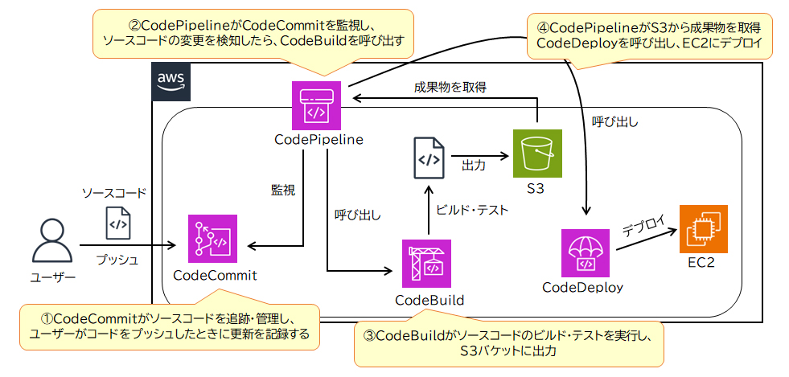
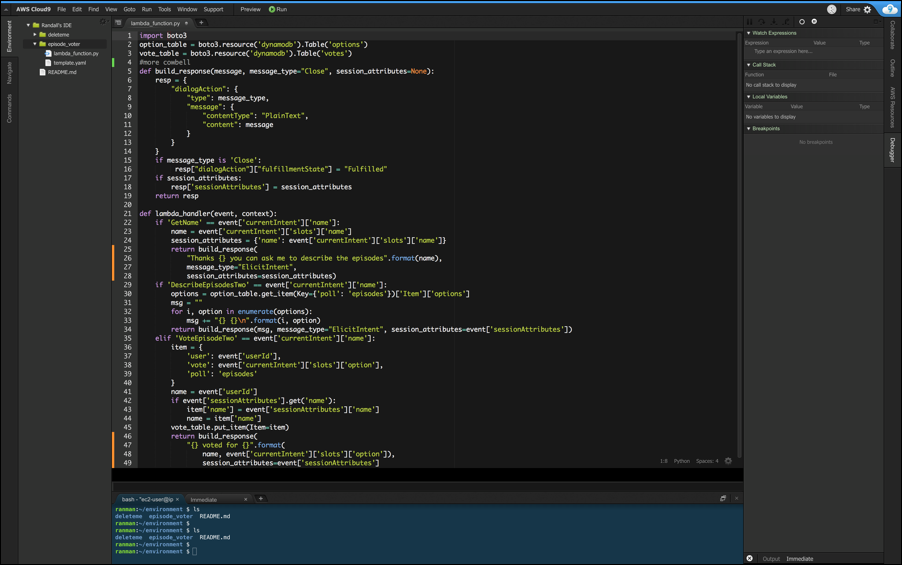

# コンピューティングサービス
## Amazon AppStream 2.0
Amazon WorkSpacesと同様に仮想デスクトップ環境を提供するサービスだが、特定アプリケーションをしたいなど管理者でユーザが利用するアプリケーションを限定したいときは、
Amazon AppStream 2.0を利用する。

# アプリケーション統合
## Amazon Simple Notification Service (Amazon SNS) 〇
## Amazon Simple Queue Service (Amazon SQS) 〇
## Amazon EventBridge

## AWS Step Functions
複数のAWSサービスをワークフローという形で連携させ、処理の自動化を行うサービス。

### AWS System Manager
オンプレミス環境のリソースの運用サポートを行う。

# デベロッパーツール

## AWS Cloud9
AWSが提供している統合開発環境(IDE)。

## AWS CodePipeline
CodeCommitを監視して、CodeCommitに変更が発生したらCodeBuildを呼び出す。というような使い方をする。
ソフトウェア開発の継続的インテグレーションや継続的デリバリーを提供するサービス

## AWS CodeDeploy
アプリケーションのデプロイを自動化し、デプロイ中にエラーが発生した際、自動でロールバックする。

## AWS X-Ray
アプリケーションの動作に関するデータを収集・分析できるサービス。
現在はAmazon CloudWatchの一部サービスとして提供されている。

## AWS Amplify
AWS Amplifyは、Webアプリケーションやモバイルアプリケーションの開発を効率化するフルスタック開発プラットフォーム。

# スタートアップ向けサービス
## AWS Managed Services
AWSが企業のAWSインフラストラクチャの運用管理を代行するサービス。
AWS自身が24時間365日セキュリティチェックやコスト最適化、自動化などの運用全般を対応する。
